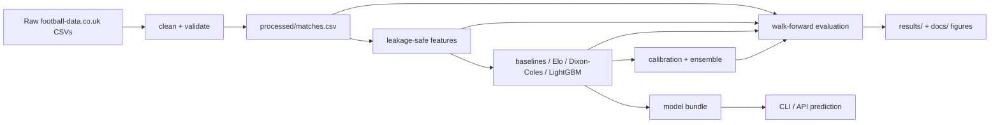

# Code guide

## 1. What this project does

Football Predictor is a research pipeline for forecasting the outcome of a single football match (home win, draw, away win) before kickoff. It downloads historical match data, cleans it, builds leakage-safe pre-match features, fits several forecasting models, compares them against a bookmaker baseline using walk-forward evaluation, and exposes forecasts through a command-line interface and an HTTP API. Results and figures are written under `results/` and `docs/`. It is not a betting tool and should not be used as betting advice. The probabilities describe how often similar pre-match situations have ended in each outcome; they are not certainties.

## 2. Pipeline diagram

## 3. Repository map

Top-level folders and files:

| Path | Stage | What it does |
|---|---|---|
| `src/footballpred/` | all | Python package implementing the pipeline. |
| `tests/` | validation | Unit and integration tests; small deterministic fixtures only. |
| `configs/default.yaml` | config | Leagues, seasons, paths, model settings, team aliases. |
| `data/raw/` | ingest | Cached source CSVs (ignored by git). |
| `data/processed/matches.csv` | ingest | Canonical cleaned match table. |
| `models/football-model.joblib` | serving | Fitted bundle (ignored by git apart from `.gitkeep`). |
| `results/` | evaluation/reporting | Generated metrics, tuning tables, (if re-run) walk-forward outputs. |
| `docs/` | reporting | Generated and hand-written (this file, figures, sample explanations). |
| `scripts/` | documentation | Helper scripts that create the trace, statistics, error analysis and runtime report. |
| `.github/workflows/ci.yml` | CI | Installs package, runs ruff and pytest, builds the Docker image. |
| `Makefile` | all | Named targets for each pipeline stage. |
| `pyproject.toml` | packaging | Build, dependency and tool configuration. |

Files inside `src/footballpred/`:

| File | Part of src | Purpose |
|---|---|---|
| `config.py` | setup | Loads YAML into pydantic models; rejects unknown keys. |
| `pipeline.py` | serving | Fits the deployable bundle, saves and loads it, enforces cutoff. |
| `cli.py` | serving | Typer commands: download, validate, evaluate, train, build-features, predict, teams. |
| `ingest/clean.py` | ingest | Date parsing, team-name normalization, source-file cleaning. |
| `ingest/download.py` | ingest | Cached HTTP download and processed-table creation. |
| `ingest/validate.py` | ingest | Missing-value, duplicate, score and odds checks; summaries. |
| `features/builder.py` | features | Leakage-safe rolling form, rest, season progress and pre-match Elo. |
| `models/base.py` | models | Base model interfaces and prediction storage. |
| `models/baselines.py` | models | Class prior and bookmaker odds de-vig. |
| `models/elo.py` | models | Elo win/draw/loss mapping and rating updates. |
| `models/dixon_coles.py` | models | Goal-scoring rate model and score matrix. |
| `models/lgbm.py` | models | LightGBM 1X2 and binary (Over 2.5, BTTS) classifiers. |
| `models/calibration.py` | models/evaluation | Temperature, Platt, isotonic calibration and selection. |
| `models/ensemble.py` | models | Validation-weighted Dixon-Coles/LightGBM blend. |
| `evaluate/splits.py` | evaluation | Season-based chronological split. |
| `evaluate/metrics.py` | evaluation | Log loss, Brier, RPS, accuracy, ECE, bootstrap helpers. |
| `evaluate/report.py` | evaluation | Phase 2/3/4 tuning, walk-forward folds, figures and artifacts. |
| `api/app.py` | serving | FastAPI routes and request validation. |
| `explain/text.py` | explain | Plain-language prediction explanations. |
| `explain/shap_utils.py` | explain | SHAP-based global and local feature importance (not covered by tests). |

Tests (`tests/`), one line each:

| File | Purpose |
|---|---|
| `test_api.py` | HTTP routes, probability shapes, 404 and 422 handling. |
| `test_calibration.py` | Calibrator transforms stay valid and selection contracts hold. |
| `test_cli.py` | CLI commands through Typer's `CliRunner`. |
| `test_config.py` | Configuration schema and fail-fast validation. |
| `test_determinism.py` | Repeated fits are deterministic; cleaned output matches a golden file. |
| `test_download.py` | Mocked HTTP download and cache behaviour. |
| `test_ingest.py` | Date parsing, team aliases and cleaned schema. |
| `test_models_evaluate.py` | Metrics, splits, models, features and explanations. |
| `test_pipeline.py` | Cutoff handling and end-to-end fitting on a tiny fixture. |
| `test_report_smoke.py` | All three evaluation phases run on a tiny fixture. |
| `test_validate.py` | Validation counters, warnings and summaries. |

## 4. CLI to stage mapping

Commands and options were verified against `footballpred --help` and each subcommand's `--help`.

| Command | Main stage | Important options | Main outputs |
|---|---|---|---|
| `footballpred download` | ingest | `-c/--config`, `--refresh` | `data/processed/matches.csv` plus `data/raw/*.csv` |
| `footballpred validate` | ingest/validation | `-c/--config` | `results/data-validation.json`, `results/data-summary.json` |
| `footballpred evaluate` | evaluation | `-c/--config` | `results/model-comparison.csv`, `results/phase3-market-comparison.csv`, `results/phase4-model-comparison.csv`, tuning CSVs, figures |
| `footballpred train` | serving | `-c/--config` | `models/football-model.joblib` |
| `footballpred build-features` | features | `-c/--config`, `-o/--output` | a feature CSV, default `data/processed/features.csv` |
| `footballpred predict` | serving | `--home`, `--away`, `--date` (all required), `--model`, `-c/--config` | JSON on standard output |
| `footballpred teams` | serving | `-c/--config` | team names on standard output |

## 5. Trace one prediction

Command to reproduce the trace:

    python scripts/trace_prediction.py

The script picks the first match of season 2024/25 from the processed data (`Man United` home, `Fulham` away, 16 August 2024, final score 1-0) and reconstructs the stages for it.

Real intermediate values from that run:

- Raw source row (from `data/raw/E0_2425.csv`): 34 fields including `FTHG=1`, `FTAG=0`, `FTR=H`, `PSCH=1.65`, `PSCH` line copied above. The home shot totals were HS=14 and AS=10.
- Cleaned row (`data/processed/matches.csv`): date 2024-08-16, home_team Man United, away_team Fulham, home_goals 1, away_goals 0, result H, psch 1.65, pscd 4.23, psca 5.28.
- Training rows available before the match: 3800.
- Pre-match Elo ratings from the feature row: elo_home 1627.37, elo_away 1511.52, elo_difference 180.86. Both teams had 89 rest days because this was the first matchday.
- Dixon-Coles 1X2 probabilities for this fixture: 0.5103 / 0.2400 / 0.2496; Over 2.5: 0.5354; BTTS: 0.5505. Top scorelines: 1-1 0.1135, 1-0 0.1013, 2-1 0.0965, 2-0 0.0864, 0-1 0.0665.
- A LightGBM model trained on the prior 3800 matches gives 1X2 probabilities 0.7082 / 0.1874 / 0.1044 for this fixture.
- The committed serving bundle (`models/football-model.joblib`) has cutoff 2026-05-24.

Functions named in this walkthrough: `clean_source_file`, `build_features`, `markets_from_score_matrix`/`DixonColesModel.predict_markets`, `LightGBM1X2.fit` and `predict_proba`, and `save_bundle`/`load_bundle`. The feature numbers come only from rows dated before the fixture date, because `build_features` snapshots all same-day fixtures before appending their scores.

## 6. Safeguards

Locations verified with `Select-String` (PowerShell) / `grep`:

| Guard label | Files (verified locations) | What it protects |
|---|---|---|
| LEAKAGE GUARD | `features/builder.py` lines 72, 90; `models/elo.py`; `models/lgbm.py`; `api/app.py` lines 132, 142; `evaluate/report.py` line 583 | Later match results cannot change earlier feature values; same-day scores cannot leak between fixtures; the API rejects retrospective dates; the imputer is fit on the training fold only; reported feature matrices do not include test labels. |
| SPLIT GUARD | `evaluate/splits.py` lines 69, 104; `pipeline.py`; `evaluate/report.py` lines 244, 824 | Training uses only seasons before validation; test seasons must follow validation; date ranges must not overlap; the expanding-window folds exclude the current test season; the API cutoff rejects on-or-before-cutoff dates. |
| NORMALIZATION | `ingest/clean.py` lines 28, 45, 92, 102; `ingest/download.py`; `models/baselines.py`; `evaluate/report.py` lines 1275, 1306; `models/dixon_coles.py` | Dates are parsed day-first; team names are whitespace-normalized and aliased; odds are converted to no-vig probabilities per row; reports are normalized before scoring. |
| ASSUMPTION | `features/builder.py`; `pipeline.py`; `cli.py`; `models/elo.py` | Notes on choices that are not derived from data: 38 matchdays for season progress, reusing the validation winner's tuning, no kickoff timestamp, conventional Elo blowout multiplier. |

## 7. How to run everything

- Install editable package and dev tools: `python -m pip install -e ".[dev]"`
- Run tests: `python -m pytest -q`
- Run lint: `python -m ruff check src tests`
- Download and clean data: `footballpred download` (uses the configured seasons; network required once)
- Validate data: `footballpred validate`
- Evaluate: `footballpred evaluate` (can take many minutes)
- Train the serving bundle: `footballpred train`
- Build features CSV: `footballpred build-features -o data/processed/features.csv`
- Predict: `footballpred predict --home "Arsenal" --away "Chelsea" --date 2026-08-01`
- API: `uvicorn footballpred.api.app:app --host 0.0.0.0 --port 8000`, then `GET /health`, `GET /teams`, `GET /predict?home=...&away=...&date=...`
- Trace: `python scripts/trace_prediction.py`

A dry run of a long stage is not required for validation; the CLI help and test suite were used for the checks in this repository.

## 8. Glossary

- **Data leakage**: Information that would not be available at prediction time is used to train or score the model. Example: using a match's final goal count to predict that same match.
- **Time-based split**: Dividing data by calendar date rather than randomly, so later matches are not in training. Example: train on 2014-2022, validate on 2023, test on 2024.
- **Walk-forward evaluation**: Repeating the time-based split on expanding windows and reporting each held-out season separately. Example: validate on 2324, then test on 2425, then test on 2526.
- **Overround**: The extra margin a bookmaker builds into prices so the summed implied probabilities exceed 1. Example: odds 2.0, 4.0 and 4.0 sum to 1.25 in implied-probability space.
- **Implied probability**: One divided by decimal odds, before removing the overround. Example: 2.0 odds implies 0.50.
- **Elo rating**: A single-team skill score updated after each match; higher means stronger. Example: a team rated 1600 is expected to beat a 1500-rated team.
- **Dixon-Coles**: A model for expected goals that produces a score matrix and derived markets. Example: it can say 1-1 is the most likely score even when both teams average 1.3 goals.
- **Poisson distribution**: A probability distribution for counts, used for goals. Example: if a team averages 1.4 goals, the chance of exactly 2 goals is a Poisson probability.
- **Score matrix**: A grid of probabilities for every (home goals, away goals) pair. Example: the (2,1) cell is the chance of a 2-1 home win.
- **Gradient boosting (LightGBM)**: A tree-based model that corrects its own errors in sequence. Example: it learns that a long rest after a heavy defeat changes the 1X2 probabilities.
- **Log loss**: The average negative log probability of the outcome that happened. Lower is better. Example: predicting the winner at 0.9 gives a small loss, 0.51 gives a larger one.
- **Brier score**: Mean squared error of probability forecasts. Lower is better. Example: if the home win probability is 0.7 and the home team wins, the contribution is 0.3 squared.
- **Ranked probability score**: A proper score for ordered outcomes that penalizes distance from the correct result. Example: predicting a home win when the result is an away win costs more than predicting a draw.
- **Calibration**: Whether predicted probabilities match observed frequencies. Example: where the model says 0.60 home win, about 60% of those matches should be home wins.
- **Expected calibration error**: Average gap between predicted confidence and observed frequency across bins. Example: ECE of 0.03 means probabilities are off by about three percentage points on average.
- **Bootstrap confidence interval**: An interval for a statistic, built by resampling the data. Example: a paired bootstrap over match-level differences says whether the model's log-loss edge over the bookmaker is likely noise.
- **SHAP**: A method for assigning each input feature a contribution to one prediction. Example: a feature "home overall points per match" may push the home-win score up by 0.12 for one fixture.
- **Baseline**: A simple reference forecast to beat. Example: always predicting the training outcome rates, or converting bookmaker odds to probabilities.
